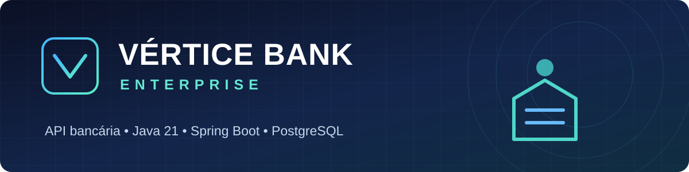
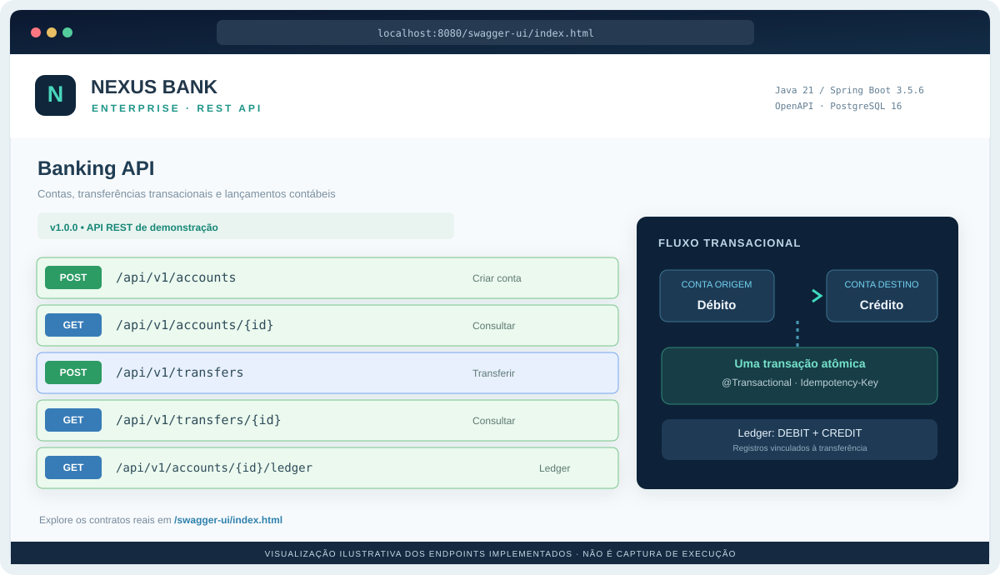
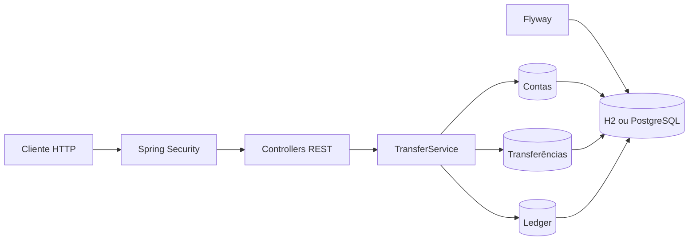

<div align="center">
  

  <br />

  [](https://openjdk.org/)
  [](https://spring.io/projects/spring-boot)
  [](https://www.postgresql.org/)
  [](https://www.docker.com/)

  [](https://github.com/WalterMatheusgg/Sistema-Bancario-Empresarial/actions/workflows/ci.yml)
  [](LICENSE)

  **API REST para simular operações bancárias, com transferências transacionais, controle de concorrência e registro contábil.**

  [Prévia visual](#-prévia-visual-da-api) · [Funcionalidades](#-funcionalidades) · [Arquitetura](#-arquitetura) · [Executar](#-como-executar) · [Endpoints](#-endpoints) · [Limitações](#-segurança-e-limitações)
</div>

---

## 🖥️ Prévia visual da API

<div align="center">
  
  <br />
  <sub>Imagem ilustrativa dos endpoints implementados, baseada nos controllers Java. Não é uma captura do servidor em execução.</sub>
</div>

O **Nexus Bank Enterprise é uma API REST**, e **não possui frontend bancário**. A interface para explorar seus recursos é o **Swagger UI**, disponível após iniciar a aplicação em [localhost:8080/swagger-ui/index.html](http://localhost:8080/swagger-ui/index.html).

A API cobre criação e consulta de contas, transferências protegidas por chave de idempotência e consulta de lançamentos contábeis. [Explore os controllers](src/main/java/dev/nexusbank/) ou [execute os testes](src/test/java/dev/nexusbank/BankIntegrationTest.java).

---

## ✨ Sobre o projeto

O **Nexus Bank Enterprise** é uma API desenvolvida com **Java 21 e Spring Boot 3** para demonstrar práticas de backend em um domínio financeiro: persistência relacional, operações atômicas, validações, idempotência, autenticação e testes de integração.

> [!IMPORTANT]
> **Projeto educacional e de portfólio, focado em backend.** Não é um banco real, não oferece aplicação frontend e não pode movimentar dinheiro em produção. H2 e credenciais de demonstração destinam-se exclusivamente ao ambiente local.

## 🚀 Funcionalidades

| Módulo | O que oferece |
| :--- | :--- |
| 💳 **Contas** | Criação de contas em BRL, consulta de saldo e identificação por UUID. |
| 🔁 **Transferências** | Débito e crédito na mesma transação com `@Transactional`. |
| 🔒 **Concorrência** | Bloqueio pessimista com ordem determinística de contas para reduzir risco de deadlock. |
| 🔑 **Idempotência** | Cabeçalho `Idempotency-Key`, identificação de requisições repetidas e rejeição de conflitos. |
| 📒 **Ledger** | Registro de duas entradas por transferência: `DEBIT` e `CREDIT`. |
| 🛡️ **API protegida** | HTTP Basic, senha codificada com BCrypt e validação de requisições. |
| 🗃️ **Persistência** | Spring Data JPA, Flyway, H2 local e PostgreSQL via Docker Compose. |
| 🧪 **Qualidade** | Testes JUnit 5, pipeline GitHub Actions e Actuator Health. |
| 📖 **Documentação** | Swagger UI e OpenAPI para exploração dos endpoints. |

## 🧰 Tecnologias

**Backend:** Java 21 · Spring Boot 3.5.6 · Spring Web · Spring Security · Spring Data JPA / Hibernate · Bean Validation

**Dados:** PostgreSQL 16 · H2 · Flyway · SQL

**Infra e testes:** Docker · Docker Compose · Maven · JUnit 5 · GitHub Actions · Springdoc OpenAPI

## 🏗️ Arquitetura



A aplicação é organizada por domínio, evitando concentrar toda a lógica nos controllers:

```text
src/
├── main/
│   ├── java/dev/nexusbank/
│   │   ├── account/          # Contas e consultas
│   │   ├── transfer/         # Transferências e regras transacionais
│   │   ├── ledger/           # Lançamentos contábeis
│   │   ├── config/           # Segurança e tratamento de erros
│   │   └── NexusBankApplication.java
│   └── resources/
│       ├── application.yml
│       └── db/migration/     # Migrações Flyway
└── test/java/dev/nexusbank/  # Testes de integração
```

## ⚡ Como executar

### Opção 1 — local, com H2

Pré-requisitos: **JDK 21** e **Maven 3.9+** instalados.

```bash
git clone https://github.com/WalterMatheusgg/Sistema-Bancario-Empresarial.git
cd Sistema-Bancario-Empresarial
mvn clean test
mvn spring-boot:run
```

A API estará disponível em `http://localhost:8080`. O H2 é **temporário**: os dados são descartados quando o processo reinicia.

**Login local de demonstração:** `admin` / `dev-only-change-me`. Troque a senha por meio de `BANK_ADMIN_PASSWORD` antes de usar fora do seu computador.

### Opção 2 — Docker + PostgreSQL

Pré-requisitos: Docker Engine e Docker Compose.

```bash
cp .env.example .env
# Edite .env e defina senhas fortes para DB_PASSWORD e BANK_ADMIN_PASSWORD
docker compose up --build -d
docker compose ps
```

O banco é persistido no volume `postgres_data`; a API é exposta apenas em `127.0.0.1:8080`. **Não versione o arquivo `.env`.**

Para desligar os containers preservando os dados:

```bash
docker compose down
```

### Links úteis

| Recurso | Endereço |
| :--- | :--- |
| Swagger UI | `http://localhost:8080/swagger-ui/index.html` |
| OpenAPI JSON | `http://localhost:8080/v3/api-docs` |
| Health check | `http://localhost:8080/actuator/health` |

## 🔌 Endpoints

| Método | Rota | Descrição |
| :---: | :--- | :--- |
| `POST` | `/api/v1/accounts` | Criar uma conta com saldo zero |
| `GET` | `/api/v1/accounts/{id}` | Consultar conta e saldo |
| `POST` | `/api/v1/transfers` | Transferir valores entre contas |
| `GET` | `/api/v1/transfers/{id}` | Consultar uma transferência |
| `GET` | `/api/v1/accounts/{id}/ledger` | Consultar lançamentos da conta |
| `GET` | `/actuator/health` | Verificar a saúde da aplicação |

### Exemplo: criar uma conta

```bash
curl -u admin:dev-only-change-me \
  -H "Content-Type: application/json" \
  -d '{"ownerName":"Alice"}' \
  http://localhost:8080/api/v1/accounts
```

### Exemplo: transferir valores

```bash
curl -u admin:dev-only-change-me \
  -H "Content-Type: application/json" \
  -H "Idempotency-Key: transferencia-demo-001" \
  -d '{"fromAccountId":"UUID_DA_CONTA_A","toAccountId":"UUID_DA_CONTA_B","amount":10.00}' \
  http://localhost:8080/api/v1/transfers
```

> [!NOTE]
> **Contas novas começam com R$ 0,00.** A API ainda não inclui endpoint de depósito. Para observar uma transferência concluída, execute os testes (`mvn test`), que criam contas de teste com saldo inicial. Uma futura implementação de depósitos exigirá conciliação e auditoria adequadas.

## 🧪 Testes e integração contínua

```bash
mvn clean verify
```

Os testes existentes cobrem transferência com lançamentos contábeis, repetição da mesma chave de idempotência e rejeição de saldo insuficiente. O workflow [Java CI](.github/workflows/ci.yml) executa `mvn verify` em pushes e pull requests.

## 🔐 Segurança e limitações

Esta versão usa **uma credencial administrativa compartilhada com HTTP Basic**. O projeto **não possui** autenticação por usuário, perfis avançados, processamento real de pagamentos ou integração bancária externa. Para uso real seriam necessários, entre outros, TLS obrigatório, gestão segura de segredos, controle de acesso granular, trilha de auditoria, reconciliação contábil, paginação e testes de concorrência no PostgreSQL. A idempotência possui uma restrição única no banco, mas conflitos simultâneos ainda merecem tratamento específico.

O ledger registra entradas de débito e crédito na aplicação, mas a consistência de dupla entrada **não é garantida por uma restrição global no banco**.

## 🗺️ Evolução planejada

- [ ] Fluxo de depósitos com trilha contábil auditável
- [ ] Autenticação com usuários, perfis e permissões
- [ ] Testes de concorrência com PostgreSQL/Testcontainers
- [ ] Auditoria, reconciliação e observabilidade
- [ ] Paginação e filtros para consultas de lançamentos


---

## 👨‍💻 Autor

**Walter Matheus** · Desenvolvedor Full Stack com foco em Java, Spring Boot e Angular.

[**Ver código-fonte**](https://github.com/WalterMatheusgg/Sistema-Bancario-Empresarial) · [**Outros projetos**](https://github.com/WalterMatheusgg?tab=repositories)

> O painel acima ilustra a documentação da API, não uma interface de internet banking.
