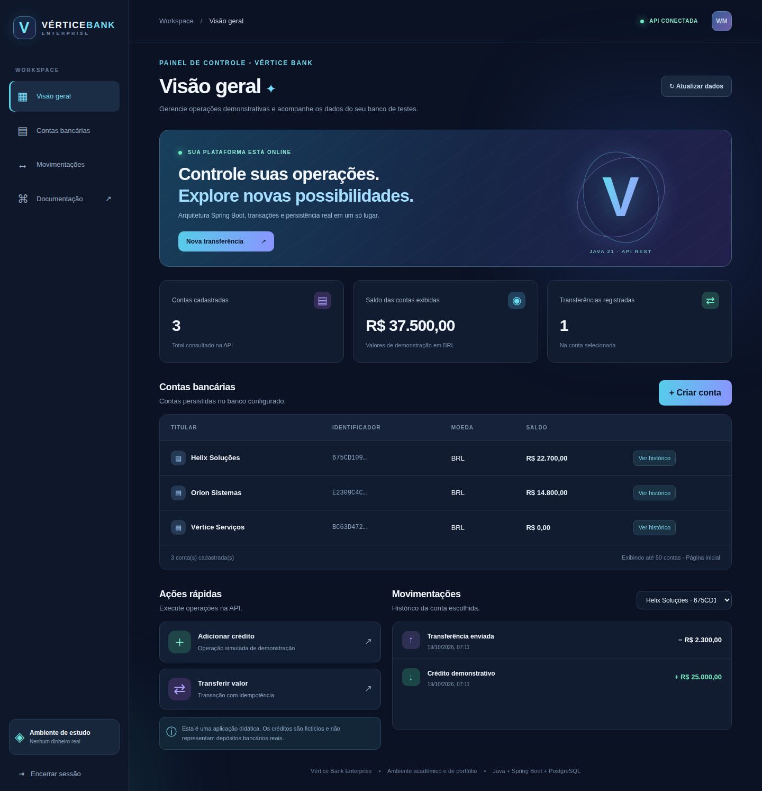
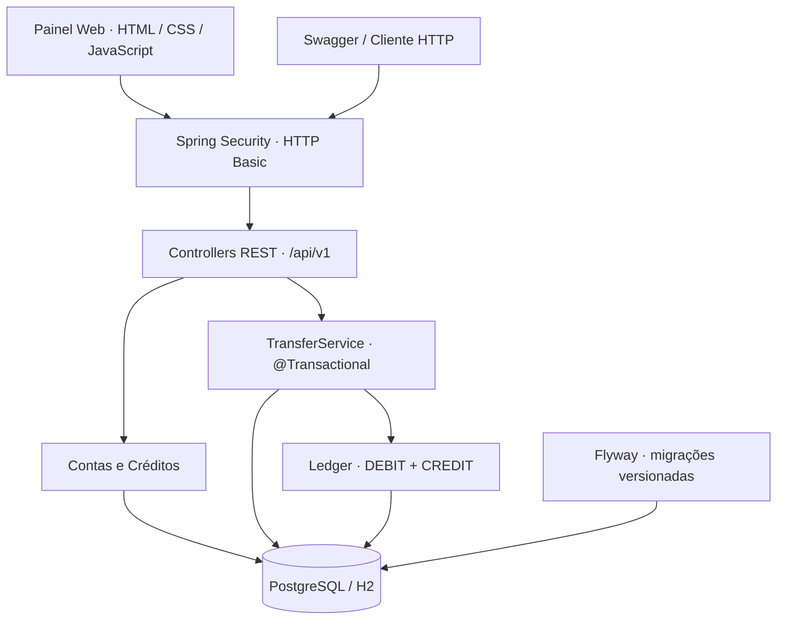

<div align="center">


# Vértice Bank
### Sistema Bancário Empresarial · Java 21 · Spring Boot · PostgreSQL

**API bancária com painel web integrado, transferências transacionais, idempotência e histórico contábil.**


[](https://github.com/WalterMatheusgg/Sistema-Bancario-Empresarial/actions/workflows/ci.yml)
[](LICENSE)

[**Dashboard**](#-painel-do-sistema) · [**Funcionalidades**](#-funcionalidades) · [**Arquitetura**](#-arquitetura) · [**Executar**](#-executar-localmente) · [**API**](#-endpoints)

</div>

---

## 🖥️ Painel do sistema

<div align="center">
  
</div>

O painel web é servido pelo próprio **Spring Boot**, em `http://localhost:8080`. Nele é possível acompanhar saldos, consultar contas e movimentações e acessar operações conectadas à API REST.

A interface utiliza **HTML5, CSS3 e JavaScript**, com acesso aos endpoints por `fetch`. O projeto preserva o foco em **engenharia backend Java**, incluindo transações, persistência e consistência dos dados.

## 🎯 Sobre o projeto

O **Vértice Bank** é um sistema bancário de portfólio voltado ao desenvolvimento e à validação de fluxos financeiros em ambiente controlado. Combina uma API REST com interface web, base de dados relacional e operações rastreáveis.

O objetivo é demonstrar técnicas aplicadas a sistemas que exigem consistência: **transações ACID, bloqueios pessimistas, validação, idempotência e lançamentos de débito/crédito**.

> [!IMPORTANT]
> **Ambiente de demonstração.** Não é uma instituição financeira nem processa pagamentos reais. Contas, créditos e transferências representam movimentações de teste.

## ✨ Funcionalidades

| Módulo | Recursos |
|:--|:--|
| 💳 **Contas** | Abertura de contas, identificação por UUID, saldos e consulta paginada |
| 🪙 **Créditos de teste** | Inclusão de saldo de demonstração com histórico e idempotência |
| 🔁 **Transferências** | Débito e crédito em uma transação atômica com `@Transactional` |
| 🔐 **Concorrência** | Locks pessimistas com ordenação determinística das contas |
| 🔑 **Idempotência** | Proteção contra repetição indevida de operações por `Idempotency-Key` |
| 📒 **Ledger** | Entradas `DEBIT` e `CREDIT` associadas às transferências |
| 📊 **Dashboard** | Contas, saldos, movimentações, formulários e indicadores conectados à API |
| 🧪 **Qualidade** | Testes de integração, Maven e GitHub Actions |
| 📖 **Documentação** | Swagger UI / OpenAPI e Actuator Health |

## 🧰 Tecnologias

| Área | Tecnologias |
|:--|:--|
| **Backend** | Java 21 · Spring Boot 3.5.6 · Spring Web · Spring Security · Spring Data JPA / Hibernate |
| **Banco de dados** | PostgreSQL 16 · H2 local · Flyway · SQL |
| **Interface** | HTML5 · CSS3 · JavaScript · Fetch API |
| **Testes e qualidade** | JUnit 5 · Spring Security Test · Maven · GitHub Actions |
| **Infraestrutura** | Docker · Docker Compose · Swagger/OpenAPI |

## 🏗️ Arquitetura



A lógica de negócio fica nos serviços e repositórios, com autenticação e tratamento de erros separados dos controllers.

```text
src/
├── main/
│   ├── java/dev/nexusbank/
│   │   ├── account/        # Contas, consultas e créditos
│   │   ├── deposit/        # Operações de crédito para testes
│   │   ├── transfer/       # Transações e idempotência
│   │   ├── ledger/         # Lançamentos contábeis
│   │   └── config/         # Segurança e respostas de erro
│   └── resources/
│       ├── static/         # Painel web
│       ├── db/migration/   # Migrações Flyway
│       └── application.yml
└── test/                   # Testes de integração
```

## 🚀 Executar localmente

### Java e Maven

Pré-requisitos: **JDK 21** e **Maven 3.9+**.

```bash
git clone https://github.com/WalterMatheusgg/Sistema-Bancario-Empresarial.git
cd Sistema-Bancario-Empresarial
mvn clean verify
mvn spring-boot:run
```

Abra **http://localhost:8080** para acessar o painel ou **http://localhost:8080/swagger-ui/index.html** para consultar a API.

O perfil local de demonstração utiliza `admin` / `dev-only-change-me`. Antes de compartilhar um ambiente, defina uma senha própria com `BANK_ADMIN_PASSWORD`. O H2 em memória não preserva dados após reiniciar o processo.

### Docker Compose + PostgreSQL

```bash
cp .env.example .env
# Defina credenciais fortes no .env
docker compose up --build -d
docker compose ps
```

A API é exposta localmente em `127.0.0.1:8080`. O PostgreSQL utiliza o volume persistente `postgres_data`.

Para encerrar sem excluir os dados:

```bash
docker compose down
```

Evite versionar o `.env` e não use `docker compose down -v` se precisar manter o volume.

## 🔌 Endpoints

| Método | Rota | Descrição |
|:--:|:--|:--|
| `POST` | `/api/v1/accounts` | Criar conta |
| `GET` | `/api/v1/accounts?page=0&size=50` | Listar contas |
| `GET` | `/api/v1/accounts/{id}` | Consultar saldo |
| `POST` | `/api/v1/accounts/{id}/deposits` | Crédito de demonstração |
| `GET` | `/api/v1/accounts/{id}/deposits` | Consultar créditos |
| `POST` | `/api/v1/transfers` | Transferir entre contas |
| `GET` | `/api/v1/transfers/{id}` | Consultar transferência |
| `GET` | `/api/v1/accounts/{id}/ledger` | Lançamentos da conta |
| `GET` | `/actuator/health` | Estado da aplicação |

### Exemplo de transferência

```bash
curl -u admin:dev-only-change-me \
  -H "Content-Type: application/json" \
  -H "Idempotency-Key: transferencia-demo-001" \
  -d '{"fromAccountId":"UUID_ORIGEM","toAccountId":"UUID_DESTINO","amount":50.00}' \
  http://localhost:8080/api/v1/transfers
```

Substitua os UUIDs por identificadores de contas e utilize uma chave de idempotência nova para cada operação distinta.

## 🧪 Testes e integração contínua

```bash
mvn clean verify
node --check src/main/resources/static/assets/app.js
```

Os testes cobrem fluxos de contas, créditos de demonstração, transferências, idempotência, saldo insuficiente e lançamentos contábeis. Consulte os workflows de [CI Java](.github/workflows/ci.yml) e [captura do painel](.github/workflows/dashboard-screenshot.yml).

## 🔒 Segurança e evolução

O sistema utiliza HTTP Basic, BCrypt e validação de entradas para o cenário de demonstração. **Não está homologado para operações bancárias reais.** Antes de qualquer uso externo seriam necessários controles adicionais, incluindo TLS, autenticação individual, autorização granular, gestão de segredos, proteção CSRF adequada, auditoria, reconciliação e testes de concorrência em PostgreSQL.

**Próximas melhorias:** permissões por usuário, ledger completo para créditos, filtros e paginação avançada, observabilidade e testes concorrentes adicionais.

---

<div align="center">

**Vértice Bank** · Engenharia Backend Java · Transações · API REST · Persistência

Desenvolvido por [**Walter Matheus**](https://github.com/WalterMatheusgg) · Licença [MIT](LICENSE)

</div>
